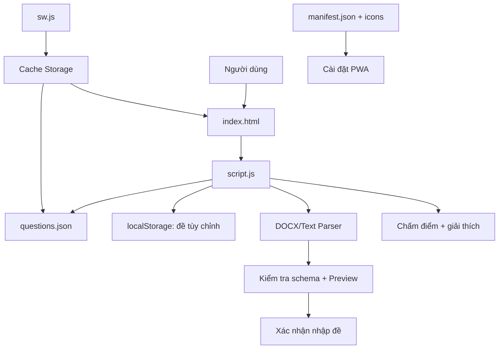
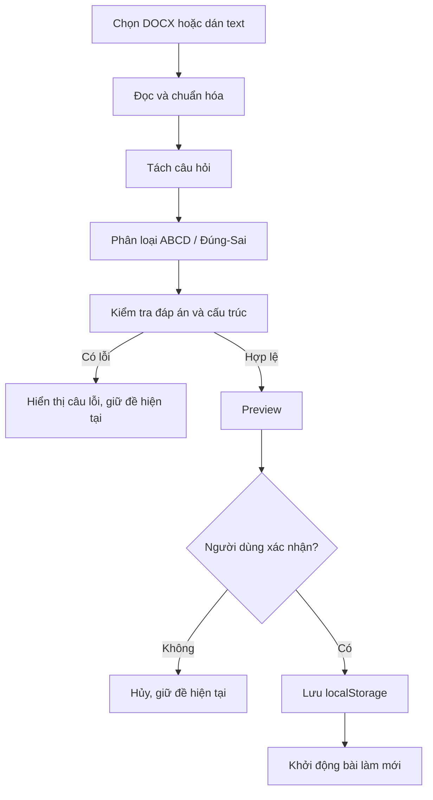
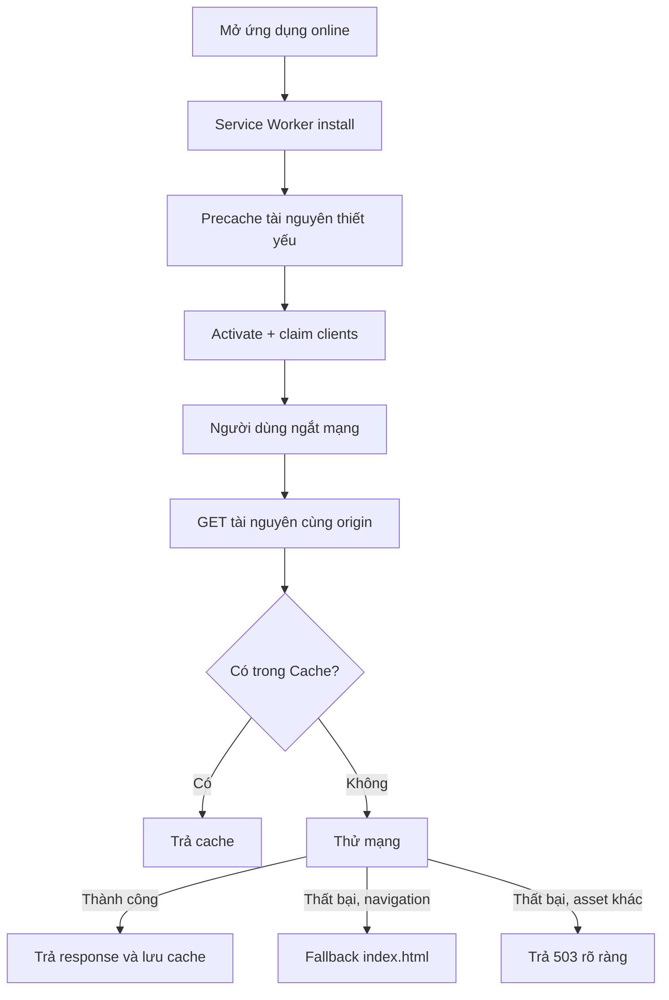

# BÁO CÁO KIỂM TOÁN VÀ NÂNG CẤP – WEB-APP PWA TIN HỌC 12

**Phiên bản:** Bản nâng cấp sau kiểm toán MASTER PROMPT v3.0  
**Ngày:** 18/11/2026  
**Phạm vi:** Mã nguồn trong ZIP, đề Word mẫu, tài liệu hướng dẫn STEM và ngân hàng câu hỏi.

## 1. Tóm tắt kết quả

Đã kiểm kê đủ 9 thành phần trong ZIP đầu vào: `index.html`, `style.css`, `script.js`, `sw.js`, `manifest.json`, `questions.json`, `De_Thi_Mau_Tin12.docx`, `icons/icon-192.png`, `icons/icon-512.png`.

Đã sửa trực tiếp trên nền mã nguồn gốc, không chuyển framework và không thêm thư viện ngoài. Bản nâng cấp có:
- Ngân hàng mặc định 26 câu.
- Bộ đọc DOCX và parser văn bản có kiểm tra dữ liệu.
- Cơ chế xem trước và xác nhận trước khi thay đề.
- Chấm điểm trắc nghiệm và Đúng/Sai theo thang bậc.
- Lưu đề tùy chỉnh bằng localStorage và khôi phục ngân hàng mặc định.
- Service Worker có cache versioning, chỉ xử lý GET cùng origin trong scope và có fallback cho điều hướng ngoại tuyến.
- Giao diện responsive, nhãn trạng thái động và thống kê kết quả.

**Chưa thể nghiệm thu toàn bộ PWA:** môi trường kiểm thử chặn điều hướng Chromium/Playwright tới `localhost` và `file://` với `ERR_BLOCKED_BY_ADMINISTRATOR`. Do đó kiểm thử DOM, Service Worker thật, cài đặt Android/iOS và chế độ máy bay được ghi là BLOCKED/NOT TESTED, không tuyên bố PASS.

## 2. Kiểm kê và đối chiếu nguồn

| Nguồn | Nội dung kiểm tra | Kết quả |
|---|---|---|
| Tài liệu hướng dẫn STEM | Mục tiêu PWA, nạp DOCX/text, localStorage, chấm điểm Đúng/Sai, Rubric | Đã đọc |
| ZIP mã nguồn | 9 thành phần ở thư mục gốc | Đủ |
| Đề Word mẫu | 6 câu: 5 ABCD + 1 Đúng/Sai | Đã trích xuất và dùng làm nguồn 6 câu gốc |
| `questions.json` đầu vào | 6 câu nhưng không khớp hoàn toàn đề Word mẫu | Đã lưu bản sao riêng để bảo toàn |
| Icons | PNG 192×192 và 512×512 | Đúng kích thước |

### 2.1. Mâu thuẫn dữ liệu gốc

Đề Word mẫu có:
- Câu 1–5: trắc nghiệm ABCD.
- Câu 6: Đúng/Sai.
- Đáp án ABCD: B, C, B, B, B.
- Đáp án Đúng/Sai: a Đúng, b Sai, c Đúng, d Đúng.

Trong khi đó `questions.json` cũ có 4 câu ABCD và 2 câu Đúng/Sai, với nội dung câu 2 và câu 5 khác đề Word mẫu. Vì MASTER PROMPT yêu cầu kiểm thử đề Word và yêu cầu giữ 6 câu của đề mẫu, ngân hàng hoạt động mới dùng 6 câu từ DOCX. Bản `questions.json` cũ được lưu nguyên trạng thành `questions_source_original_backup.json`, không bị mất.

**Hệ quả về số loại câu:** 6 câu DOCX (5 ABCD + 1 Đúng/Sai) + 20 câu mới (12 ABCD + 8 Đúng/Sai) = 17 ABCD + 9 Đúng/Sai. Điều này khác bảng tổng hợp 16 ABCD + 10 Đúng/Sai trong một mục của MASTER PROMPT. Không thể đồng thời giữ nguyên cấu trúc 5/1 của DOCX và đạt tổng 16/10 nếu vẫn thêm đúng 12/8 câu mới. Bản nâng cấp ưu tiên đề Word mẫu và cơ cấu 20 câu mới; mâu thuẫn được công khai, không đổi loại câu gốc.

## 3. Kiểm toán mã nguồn trước nâng cấp

| Mức độ | Thành phần | Lỗi/rủi ro quan sát được |
|---|---|---|
| Critical | `script.js` – render phương án/nhận định | Dùng `innerHTML` để đưa nội dung đề vào DOM; dữ liệu DOCX/text có thể chứa HTML/script không đáng tin cậy. |
| High | Parser ABCD | Nếu không tìm thấy đáp án, tự mặc định `answer = 0` (A); chấp nhận từ 2 phương án trở lên thay vì đúng 4; có thể nhập câu thiếu đáp án. |
| High | Parser Đúng/Sai | Nếu thiếu đáp án một nhận định, mặc định `true`; có thể biến dữ liệu thiếu thành đáp án đúng giả. |
| High | Nạp đề | Ghi đè ngân hàng đang làm ngay sau khi parser trả về một số câu; không có preview, không chặn nhập một phần, không rollback nếu lưu localStorage lỗi. |
| High | DOCX | Quét local ZIP header bằng cách dò chữ ký; phụ thuộc kích thước nén nằm ở local header, có thể không đọc đúng các DOCX dùng data descriptor. Regex XML không giải mã đầy đủ entity/tab/break. |
| High | Service Worker | Bắt mọi request, kể cả khác origin và không phải GET; có thể gọi cache.put với request không hợp lệ; cache.put không được chờ; lỗi mạng không có fallback rõ ràng. |
| High | Cache cleanup | Xóa mọi cache trên origin có tên khác cache của ứng dụng, có thể ảnh hưởng ứng dụng khác cùng origin. |
| Medium | Khôi phục mặc định | Gọi hàm tải dữ liệu bất đồng bộ nhưng render ngay sau đó, có nguy cơ race condition. |
| Medium | Khởi tạo | Không xác thực ngân hàng JSON hoặc đề localStorage trước khi render. |
| Medium | Giao diện | Nhãn mặc định ghi 4 câu và tiến trình Câu 1/10 dù JSON có 6 câu; số lượng bị hardcode. |
| Medium | Kết quả | Nhận xét “Xuất sắc!” cố định; chưa có thống kê câu đúng trọn vẹn/chưa trọn vẹn. |
| Low | Responsive/accessibility | CSS chưa có media query và focus state rõ ràng; vùng chọn tệp là phần tử div chưa có hỗ trợ bàn phím. |

## 4. Các thay đổi đã triển khai

### 4.1. Ngân hàng câu hỏi và schema

- Giữ nguyên nội dung, phương án, đáp án và lời giải của 6 câu trong đề Word mẫu.
- Thêm đúng 20 câu mới: 12 `multiple_choice`, 8 `true_false`.
- 10 câu mới thuộc Mạng máy tính; 10 câu mới thuộc Cơ sở dữ liệu.
- Mỗi chủ đề có 6 câu ABCD và 4 câu Đúng/Sai.
- Phân bổ độ khó: 6 Nhận biết, 8 Thông hiểu, 6 Vận dụng.
- `questions.json` dùng đúng schema gốc: `multiple_choice` có `options` array và `answer` index 0–3; `true_false` có `items` gồm a/b/c/d với boolean.
- Bảng độ khó và nguồn tham khảo để trong `question_metadata.json`, không đưa trường lạ vào schema runtime.
- Các câu mở rộng như DHCP/DNS, RFC1918, subnet mask, TCP, firewall, WHERE, ORDER BY, UPDATE, DELETE, khóa ngoại được gắn nguồn trong metadata. Vì tài liệu STEM chỉ nêu phạm vi Mạng/CSDL ở mức khái quát, giáo viên nên duyệt các nội dung mở rộng trước khi dùng làm đề chính thức.

### 4.2. Parser và nạp đề

- DOCX được đọc qua ZIP Central Directory, lấy `word/document.xml`, hỗ trợ phương thức Stored/Deflate.
- XML được xử lý bằng `DOMParser` và namespace WordprocessingML; giữ thứ tự đoạn văn, đọc nội dung trong bảng, xử lý tab và line break.
- Giới hạn file 12 MB; lỗi định dạng, thiếu XML hoặc thuật toán nén không hỗ trợ được báo rõ.
- Parser nhận dạng tiêu đề câu, phương án A–D, nhận định a–d, đáp án đơn và đáp án Đúng/Sai tổng hợp.
- Không tự gán A hoặc tự gán Đúng khi thiếu đáp án.
- Câu ABCD phải có đúng 4 phương án; Đúng/Sai phải có đủ 4 nhận định và đủ đáp án.
- Nếu một câu lỗi, toàn bộ lần nhập bị chặn; ngân hàng đang làm không bị thay thế.
- Có preview số câu, loại câu, số lỗi và danh sách câu lỗi; người dùng phải xác nhận lần hai mới nhập.
- Đề được đọc/xử lý ở trình duyệt; không gửi file lên máy chủ.

### 4.3. An toàn và lưu trữ

- Loại bỏ việc chèn nội dung đề bằng `innerHTML`; nội dung động dùng `textContent`/DOM node.
- Xác thực schema trước khi render hoặc lưu.
- Lưu hai khóa tương thích: `tin12_custom_exam`, `tin12_custom_exam_title`.
- Ghi localStorage có rollback nếu thao tác lưu thất bại.
- Khôi phục mặc định sử dụng bản ngân hàng đã tải và đã xác thực, không render trước khi tải xong.
- ID câu hỏi được dùng làm khóa câu trả lời, tránh sai lệch khi xáo trộn.

### 4.4. Chấm điểm

- ABCD đúng: 0,25 điểm; sai: 0.
- Đúng/Sai theo đúng bậc: 0/4 = 0; 1/4 = 0,1; 2/4 = 0,25; 3/4 = 0,5; 4/4 = 1,0.
- Điểm cuối được chuẩn hóa theo tổng điểm tối đa thực tế của đề về thang 10.
- Có xử lý mẫu số bằng 0.
- Màn hình kết quả hiển thị điểm, tỷ lệ điểm, tổng câu, số câu đúng trọn vẹn và số câu chưa trọn vẹn; nhận xét thay đổi theo điểm.

### 4.5. PWA và UI

- Cache version mới: `tin12-pwa-cache-v3`.
- Precache các tài nguyên thiết yếu: HTML, CSS, JS, JSON, manifest và icons.
- Chỉ xử lý request GET cùng origin trong scope; không chặn POST và request khác origin.
- Dọn cache cũ chỉ trong namespace `tin12-pwa-cache-*`, không xóa cache ứng dụng khác.
- Cache-first; điều hướng ngoại tuyến có fallback về `index.html`.
- Manifest khai báo `id`, `scope`, `start_url`, `standalone`, theme và icons.
- Đường dẫn tài nguyên dùng tương đối để hỗ trợ GitHub Pages dạng repository subpath.
- Bổ sung responsive breakpoints, focus state, reduced motion, trạng thái nút disabled và hỗ trợ bàn phím cho vùng chọn tệp.

## 5. Kiến trúc

### Luồng nạp đề

### Luồng ngoại tuyến

## 6. Nguồn kiểm chứng kiến thức mới

Nguồn tham khảo được liệt kê đầy đủ trong `question_metadata.json`. Các nguồn tiêu biểu:
- RFC 2131 về DHCP; RFC 1918 về dải IPv4 riêng; RFC 5227 về phát hiện xung đột địa chỉ IPv4; RFC 950 về subnetting.
- Cisco về switch/MAC table và chính sách lọc firewall.
- Microsoft Learn về bảng/record/field, khóa ngoại, SELECT/WHERE, ORDER BY, INSERT, UPDATE, DELETE.
- RFC 9293 về TCP; Cloudflare Learning Center về DNS.

Các nội dung kỹ thuật chi tiết chưa được giải thích trong tài liệu hướng dẫn STEM được ghi nguồn ngoài và cần giáo viên xác nhận phạm vi phù hợp.

## 7. Đối chiếu Rubric giáo viên

| Tiêu chí | Điểm tối đa | Trạng thái hiện tại |
|---|---:|---|
| Nội dung kiến thức Tin học 12 | 3,0 | Đã có 20 câu mới, cân đối Mạng/CSDL và đủ hai dạng. Cần giáo viên duyệt các phần mở rộng theo nguồn ngoài trước khi chấm mức Tốt. |
| Kỹ thuật PWA, nạp Word/Text, ngoại tuyến | 3,0 | Mã nguồn đã nâng cấp và có unit/mock tests; kiểm thử trình duyệt/thiết bị/GitHub Pages còn BLOCKED hoặc NOT TESTED nên chưa xác nhận mức Tốt. |
| Thẩm mỹ UI/UX | 2,0 | Đã thêm responsive/focus/accessibility cơ bản; chưa có ảnh chụp và thử trên thiết bị thực nên chưa chấm điểm chính thức. |
| Báo cáo và phản biện | 2,0 | Có báo cáo, sơ đồ và nhật ký test; năng lực thuyết trình/phản biện của nhóm không thể đánh giá từ mã nguồn. |

**Không đưa ra tổng điểm Rubric** khi chưa có kiểm thử thiết bị và phần trình diễn nhóm.

## 8. Vấn đề còn tồn tại và bước nghiệm thu tiếp

1. Mở gói trên Chrome/Edge và Safari thực tế; kiểm tra giao diện ở điện thoại nhỏ, tablet và desktop.
2. Nạp trực tiếp `De_Thi_Mau_Tin12.docx` trên trình duyệt; xác nhận đủ 6 câu và đúng đáp án.
3. Thử DOCX có bảng, nhiều đoạn, tab, ký tự đặc biệt, thiếu đáp án, file hỏng và file lớn.
4. Kiểm thử localStorage: nhập đề, tải lại trang, khôi phục mặc định, mô phỏng quota error.
5. Deploy lên GitHub Pages, chờ Service Worker install/activate, bật chế độ máy bay và làm hết bài.
6. Thử cài đặt trên Android Chrome và iOS Safari.
7. Giáo viên duyệt các câu mở rộng và xác nhận cách xử lý mâu thuẫn 17/9 so với bảng 16/10 trong MASTER PROMPT.

**Kết luận:** Bản mã nguồn và ngân hàng 26 câu đã được tạo, kiểm tra cấu trúc và chạy unit tests. Chưa thể gọi sản phẩm là đã nghiệm thu PWA ngoại tuyến thực tế vì kiểm thử browser/thiết bị bị chặn trong môi trường hiện tại.
